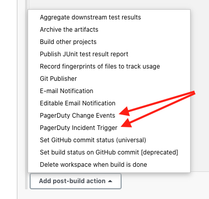
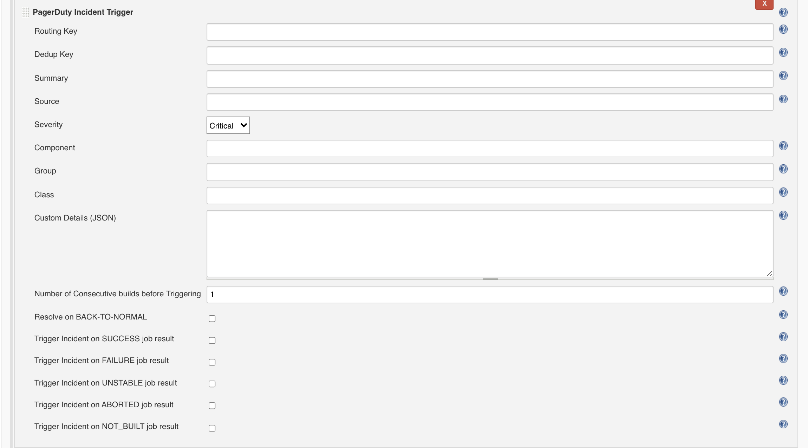
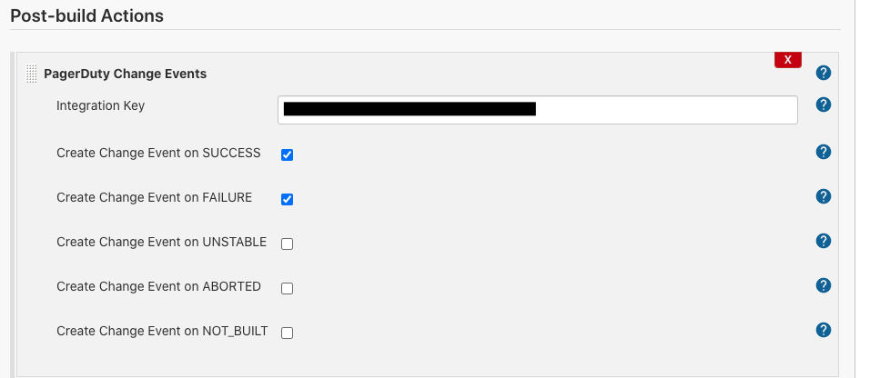
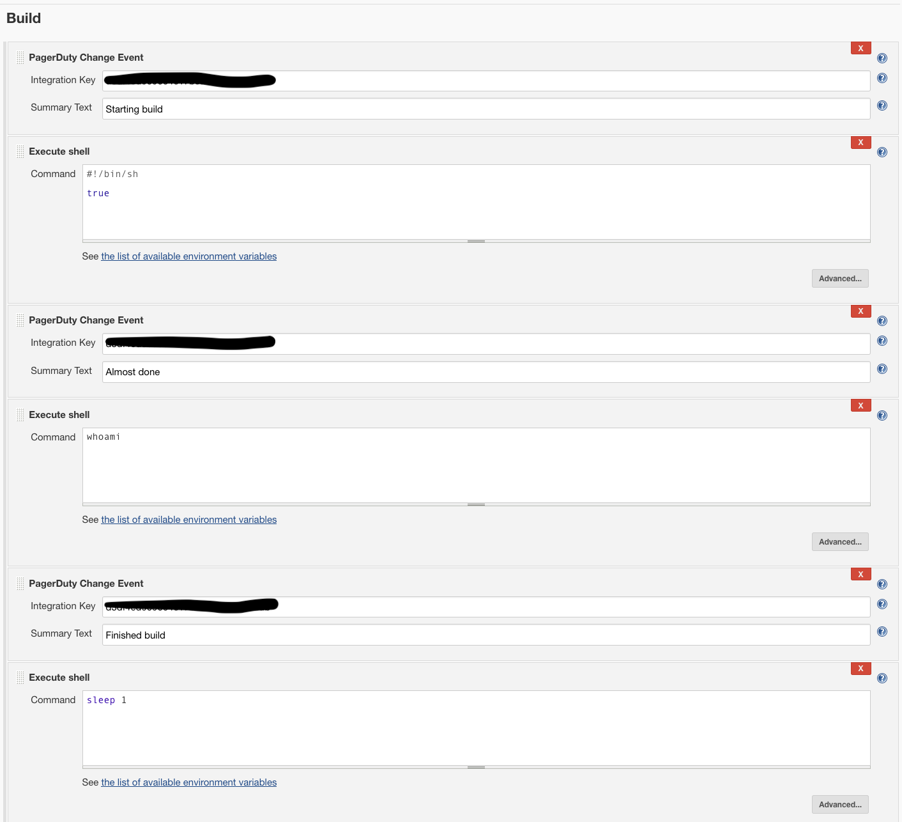
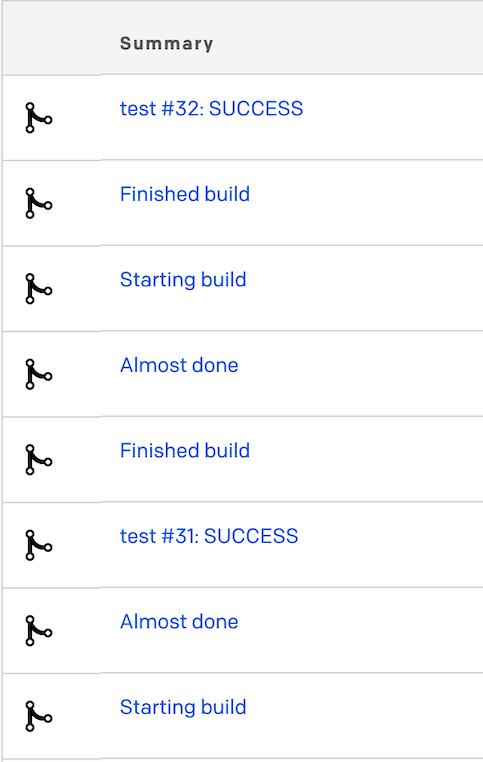

PagerDuty plugin
====================

[](https://gitter.im/jenkinsci/pagerduty-plugin?utm_source=badge&utm_medium=badge&utm_campaign=pr-badge)
[](https://plugins.jenkins.io/pagerduty)
[](https://github.com/jenkinsci/pagerduty-plugin/releases)
[](https://plugins.jenkins.io/pagerduty)


## About this plugin

Allows users to send **Change Events** and trigger postbuild **Incidents** via
[PagerDuty](https://www.pagerduty.com/)

#### Features

-   Support for PagerDuty [Change Events](https://support.pagerduty.com/docs/change-events) API
-   Trigger incidents on various job statuses
    Success/Failure/Aborted/Unstable/Not\_Built
-   Trigger incidents based on number of consecutive build results
-   Automatically **Resolve** incidents when job is **back to normal**
-   Attach **custom details** to incidents and change events
-   Configurable PagerDuty domain (for example EU-hosted accounts)
-   Incident events honour the Jenkins proxy configuration
-   Pipeline compatible
-   TokenMacro consumer
    ([TokenMacro](https://plugins.jenkins.io/token-macro) -
    adds reusable macro expansion capability)

---

## Requirements

-   Jenkins version 2.379 or newer is required.
-   Java 11 or newer is required.
-   PagerDuty account (you can create a [free developer account
    here](https://signup.pagerduty.com/accounts/new))


## Usage

### Getting Started

Before you can use this plugin you'll need an **integration key** (also known as a **routing key**). This key tells PagerDuty which service the incoming event should be sent to. If you already have a service in PagerDuty you can [add an integration to it](https://support.pagerduty.com/docs/services-and-integrations#add-integrations-to-an-existing-service); otherwise, you can add the integration when [creating a new service](https://support.pagerduty.com/docs/services-and-integrations#create-a-new-service).

For the integration type, choose **Events API V2**. This is the type required for triggering and resolving incidents. The "Jenkins CI" integration type is intended for change events only. The key is 32 characters long; a 20 character PagerDuty REST API key will not work.

Once you have an integration key you can add the appropriate action to your Jenkins project and supply it with the integration key. Be sure to select which job results you want to send an event to PagerDuty.

NOTE - PagerDuty answers `success` / `Event processed` for any well-formed key, including one that does not belong to an integration. If the build log reports success but nothing shows up in PagerDuty, check the key and the integration type first.

---
## IMPORTANT!


 **There is a break in backwards compatibility between versions 0.4.x and 0.6.x**

 if you are migrating from earlier versions to 0.6.x and above note the following changes:

-    serviceKey is replaced with **routingKey**
-    incidentKey is replaced with **dedupKey**
-    incDescription/incDetails are replaced with **incidentSummary**
-    please note the new fields introduced starting version 0.6.x

---
### Pipeline

#### Trigger/Resolve Incidents

PLEASE NOTE -
routing key and integration key are the same thing!


```
pagerduty(resolve: false, routingKey: "$ROUTING_KEY [NOT NULL]", 
dedupKey:"$DEDUP_KEY", incidentSummary:"$INCIDENT_SUMMARY", 
incidentSource: "$INCIDENT_SOURCE", incidentSeverity:"$INCIDENT_SEVERITY",
incidentComponent:"$INCIDENT_COMPONENT", incidentGroup:"$INCIDENT_GROUP", incidentClass:"$INCIDENT_CLASS",
customDetails: [key1: "value1", ... , keyN: "valueN"])
```


if resolve == false, pagerduty triggers an incident and returns the
dedup key. If you did not supply a `dedupKey`, PagerDuty generates one.

if resolve == true, pagerduty resolves the incident with the given `dedupKey`:

```
def key = pagerduty(resolve: false, routingKey: "$ROUTING_KEY",
    incidentSummary: "Deploy failed", incidentSource: "jenkins")
// ...
pagerduty(resolve: true, routingKey: "$ROUTING_KEY", dedupKey: key,
    incidentSummary: "Deploy failed", incidentSource: "jenkins")
```

When `incidentSummary` and `incidentSource` are both set on a resolve, they are sent along with it.
This matters if you use PagerDuty Event Orchestration rules that route on those fields.

NOTE - To include Custom Details in the step, specify them via a Map as shown above.

#### Change Events

`pagerdutyChangeEvent(integrationKey: '$INTEGRATION_KEY')`

Optional parameters are `summaryText` and `customDetails`. For this step `customDetails` is a JSON string, not a Map:

```
pagerdutyChangeEvent(integrationKey: '$INTEGRATION_KEY', summaryText: 'Deploy started',
    customDetails: '{"version": "1.2.3"}')
```

#### PagerDuty Domain

All actions and steps accept an optional `pagerDutyDomain` (for example `events.eu.pagerduty.com` for
EU-hosted accounts). When omitted, events are sent to `events.pagerduty.com`. Only the host (and optional port)
is used, and environment variables and token macros are expanded in freestyle jobs.

```
pagerduty(routingKey: "$ROUTING_KEY", pagerDutyDomain: "events.eu.pagerduty.com")
pagerdutyChangeEvent(integrationKey: '$INTEGRATION_KEY', pagerDutyDomain: 'events.eu.pagerduty.com')
```

#### Proxy

Incident trigger and resolve events are sent through the proxy configured in Jenkins
(*Manage Jenkins* > *System* > *HTTP Proxy Configuration*), including the proxy user name and password.
Change events do not use the Jenkins proxy configuration yet.

---
You can choose one (or both) of the options to use PagerDuty




### Trigger/Resolve Incidents

Using the "PagerDuty Incident Trigger" action, you can trigger or resolve incidents based on the results of a job.

NOTE - To include Custom Details in the trigger, specify them as a JSON object in the textbox,
for example `{"team": "ops", "build": "${BUILD_NUMBER}"}`. Environment variables and token macros are expanded.
Leave the field empty to send no custom details.

When the job goes back to normal, the incident is resolved using the same dedup key, summary and source
as the trigger. Environment variables and token macros in those fields are expanded on resolve as well.




### Create Change Events

Using the "PagerDuty Change Events" action, you can create a [change event](https://support.pagerduty.com/docs/change-events) when a job completes.





### Create Change Events From A Freestyle Job

The configuration of a freestyle job allows for including PagerDuty
change events as build steps by passing the integration key, a
custom summary text field and custom details in JSON format. If the summary text field is left blank,
the default description of the Jenkins build job and its build number
are used. Custom details are optional.  Any custom details provided will be merged into the default 
custom detail fields (build number, cause, duration). Token substitution works on all fields.  Note in the post build
version, you need to use a slightly different syntax.  Ex. ${ENV, var="PD_INTEGRATION_KEY"}  


Here's an example of a freestyle job configuration page:



The PagerDuty change event results of the above freestyle job are
shown below:




## Version History

#### Version 0.8.0 (Nov 2026)
(thanks [Johno Crawford](https://github.com/johnou), [Andre Cloutier](https://github.com/andrecloutier) and [Raghav Sai](https://github.com/petgoldfish)!)
-   <<< **REQUIRES Jenkins 2.379 or newer and Java 11 or newer** >>>
-   Replace the PagerDuty client library with the JDK HTTP client. Fixes the thread leak on repeated notifications (JENKINS-53214)
-   Incident events honour the Jenkins proxy configuration, including proxy authentication
-   Configurable PagerDuty domain (`pagerDutyDomain`) for all actions and steps
-   Custom details for incident triggers, in freestyle jobs and in the `pagerduty` step (JENKINS-64892)
-   Resolve events carry the incident summary and source, so Event Orchestration rules that route on them match (JENKINS-75964)
-   Environment variables and token macros are expanded on resolve, so a dedup key with variables resolves the right incident (JENKINS-36482)
-   Dependency updates (jackson-databind 2.18.11, commons-io 2.14.0, commons-lang3 3.18.0)

#### Version 0.7.1 (Dec 15, 2022)
-   Token macro support for the change event integration key
-   Configuration form for the pipeline steps (JENKINS-68311)
-   Additional trigger options in the `pagerduty` step

#### Version 0.7.0 (Mar 31, 2021)
(thanks [Bryan Bishop](https://github.com/bjbishop) and [Adam Krapfl](https://github.com/akrapfl)!)
-   ChangeEvent custom summary text
-   Support for tokenized strings in ChangeEvent 
-   Freestyle job change events (Resolves JENKINS-64774 and #51)
-   Bug Fixes

#### Version 0.6.2 (Jan 03, 2021)
-   Documentation Fix
-   Bug Fixes (Resolves JENKINS-64485 and #43)

#### Version 0.6.1 (Dec 08, 2020)

-   Add **Change Events** support (thanks [Adam Vaughan](https://github.com/adamvaughan)!)
-   Bug fixes
-   Remove Jetty dependency from pom
-   Move docs to Github

#### Version 0.6.0 (Dec 06, 2020)
-   Add **Change Events** support (thanks [Adam Vaughan](https://github.com/adamvaughan)!)
-   Bug fixes
-   <<< **THIS VERSION BREAKS BACKWARDS COMPATIBILITY WITH EARLIER VERSIONS** >>>

#### Version 0.4.1 (Mar 12, 2019)

-   Add **TokenMacro** support
-   Bug fixes
-   Code refactor

#### Version 0.3.0 (Jan 31, 2017)

-   Pipeline compatible
-   Code refactor

#### Version 0.2.6 (June 20, 2017)

-   Bug fixes
-   PagerDuty v2 compatibility (migrating from
    [square](https://github.com/square/pagerduty-incidents) PD utility
    to [dikhan's](https://github.com/dikhan/pagerduty-client) PD client)

#### Version 0.2.5 (March 10, 2017)

-   Bug fixes

#### Version 0.2.4 (March 30, 2016)

-   Allow automatic resolution of the incident on ***BACK-TO-NORMAL***
    (from **not** success to **success**)

#### Version 0.2.3 (March 09, 2016)

-   Bug fixes

#### Version 0.2.2 (January 03, 2016)

-   Allow triggering alert in all job statuses
    (SUCCESS/FAILED/ABORTED/UNSTABLE/NOT\_BUILT)
-   Allow using multiple service keys for different job

#### Version 0.2.1 (December 08, 2015)

-   Allow using Environment Variables for config

#### Version 0.2.0 (September 26, 2015)

-   Initial public release

---

